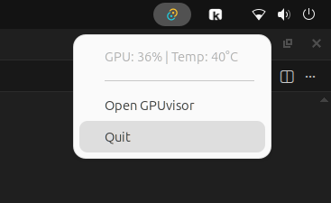
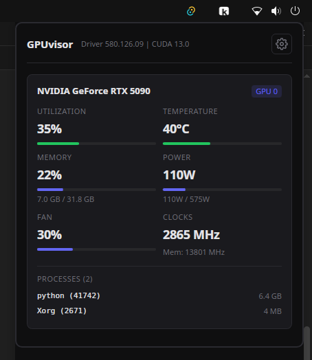
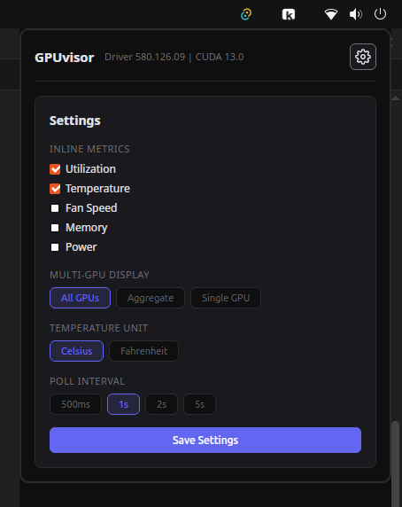

# GPUvisor

A lightweight system tray app for monitoring NVIDIA GPUs on Linux.

 

<p align="left">
  <br>
  
</p>

## Features

- **System tray** with live GPU stats (configurable: utilization, temp, memory, power, fan)
- **Detail panel** — frameless popover with per-GPU cards showing all metrics in real-time
- **Process list** — see which processes are using each GPU
- **Multi-GPU** — show all GPUs, a single GPU, or aggregate stats
- **Settings** — choose inline metrics, temperature unit (C/F), poll interval
- **Lightweight** — ~3 MB .deb, polls via NVML (no `nvidia-smi` subprocess)

<p align="left">
  
</p>

## Metrics

| Metric | Inline | Detail Panel |
|--------|--------|-------------|
| GPU Utilization | Yes | Yes |
| Temperature | Yes | Yes |
| Fan Speed | Yes | Yes |
| Memory Usage | Yes | Yes (with bar) |
| Power Usage | Yes | Yes (with bar) |
| Clock Speeds | — | Yes |
| Processes | — | Yes |

## Install

### From .deb (Ubuntu/Debian)

```bash
sudo apt install ./GPUvisor_0.1.0_amd64.deb
```

### From .AppImage

```bash
chmod +x GPUvisor_0.1.0_amd64.AppImage
./GPUvisor_0.1.0_amd64.AppImage
```

### Runtime dependencies

- NVIDIA drivers (provides NVML)
- `xdotool` — `sudo apt install xdotool`

## Build from source

### Prerequisites

```bash
# Rust
curl --proto '=https' --tlsv1.2 -sSf https://sh.rustup.rs | sh

# Node.js (for Tauri CLI)
# https://nodejs.org/

# System libraries
sudo apt install libwebkit2gtk-4.1-dev libgtk-3-dev libayatana-appindicator3-dev \
  librsvg2-dev libgdk-pixbuf-2.0-dev libcairo2-dev libsoup-3.0-dev \
  libatk1.0-dev libpango1.0-dev libjavascriptcoregtk-4.1-dev xdotool
```

### Build

```bash
npm install
npm run build
```

Bundles are output to `src-tauri/target/release/bundle/`.

### Development

```bash
npm run dev
```

## Tech Stack

- **Tauri v2** — system tray, webview window
- **Rust** — backend, GPU polling via `nvml-wrapper` crate
- **NVML** — NVIDIA Management Library (direct GPU access, no CLI parsing)
- **Vanilla JS/CSS** — frontend, no framework

## License

MIT
